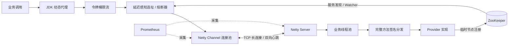

# 基于 Netty 与 ZooKeeper 的轻量级 RPC 框架

这是一个面向学习与工程实践的 Java RPC 框架，覆盖协议路由、服务注册发现、长连接通信、客户端治理、可观测性以及自动化故障验证。项目用于理解 RPC 核心机制，不宣称替代 Dubbo、gRPC 等生产级框架。

## 项目结构

```text
rpc-api             共享接口、模型和 RPC 协议
netty-consumer      RPC 客户端、代理与服务发现
netty-server-demo   RPC 服务端与提供者示例
rpc-service         消费者示例应用
```

项目保持四个 Maven 模块，不再为少量协议类单独建立 common 模块。

## 系统架构



一次调用依次经过动态代理、限流、健康节点选择、Netty连接、服务端业务线程池和反射分发。请求通过唯一ID匹配异步响应；节点超时或服务异常时，客户端在未尝试的健康节点之间进行故障转移。

## 启动 ZooKeeper

打开 WSL Ubuntu，执行：

```bash
cd /mnt/d/apache-zookeeper-3.8.6-bin
bin/zkServer.sh start
bin/zkServer.sh status
```

若出现：

```text
Mode: standalone
```

说明 ZooKeeper 已正常启动。

---

ZooKeeper 地址可以通过 JVM 参数覆盖：

```text
-Drpc.zookeeper.address=127.0.0.1:2181
```

## 停止 ZooKeeper

项目使用结束后执行：

```bash
cd /mnt/d/apache-zookeeper-3.8.6-bin
bin/zkServer.sh stop
```

检查是否停止：

```bash
bin/zkServer.sh status
```

## 启动示例

先运行 `com.rpc.server.SpringServer`，再运行
`com.rpc.service.ClientApplication`。

默认单元测试不依赖 ZooKeeper：

```bash
mvn clean test
```

## 长连接心跳

客户端和服务端均会在连接写空闲 15 秒后发送 `ping`，收到后立即回复 `pong`；任一端连续 45 秒未收到数据会主动关闭连接。客户端检测到连接关闭后，会通过现有连接管理器自动重连。

心跳消息由 I/O 线程直接处理，不进入 RPC 反序列化和业务线程池。

## RPC 协议能力

- 支持零参数、单参数和多参数方法。
- 命令使用 `接口名#方法名(参数类型...)` 完整签名，能够准确路由重载方法。
- 服务端依据方法的泛型参数类型逐项反序列化，同时保留旧版 `content` 字段兼容能力。
- 业务接口直接返回领域对象、集合或基础类型；`RpcResponse` 仅作为内部传输协议响应，不再侵入业务 API。
- 客户端依据方法的泛型返回类型还原结果（例如 `List<User>`）；协议失败统一抛出带错误码和请求 ID 的 `RpcException`。

```java
public interface UserRemote {
    User saveUser(User user);
    List<User> saveUsers(List<User> users);
    String findUser(long id, String name);
}
```

## 客户端治理

客户端在调用路径中提供按服务令牌桶限流、节点 EWMA 延迟与并发负载选择、慢调用惩罚、连续失败熔断、半开探测，以及超时/发送失败/服务异常时的跨节点故障转移。

可通过 JVM 参数调整：

| 参数 | 默认值 | 含义 |
| --- | ---: | --- |
| `rpc.request.timeout.ms` | 3000 | 单次调用超时 |
| `rpc.failover.max-attempts` | 3 | 最大尝试节点数 |
| `rpc.circuit.failure-threshold` | 3 | 连续异常或慢调用熔断阈值 |
| `rpc.circuit.open.ms` | 10000 | 熔断窗口 |
| `rpc.slow-call.ms` | 500 | 慢调用阈值 |
| `rpc.rate-limit.per-second` | 1000 | 每个服务每秒补充令牌数 |
| `rpc.rate-limit.burst` | 1000 | 每个服务突发容量 |

> 故障转移可能重新执行远程方法，生产场景应为写操作增加幂等键或仅对幂等接口开启重试。

## Prometheus 与压测

默认暴露以下端点：

- 服务端：`http://127.0.0.1:9091/metrics`
- 客户端：`http://127.0.0.1:9092/metrics`

指标覆盖调用量、成功/失败、调用延迟、重试、熔断、限流以及 JVM 内存和线程数。可用 `-Drpc.metrics.enabled=false` 关闭，或通过 `rpc.server.metrics.port`、`rpc.client.metrics.port` 修改端口。

仓库提供 [Prometheus 抓取配置](monitoring/prometheus.yml)。启动 Prometheus 后访问 `http://127.0.0.1:9090`：

```powershell
docker run --rm -p 9090:9090 `
  -v "${PWD}/monitoring/prometheus.yml:/etc/prometheus/prometheus.yml" `
  prom/prometheus
```

### 自动化压测

推荐使用 PowerShell 一键脚本。它会检查 Maven、ZooKeeper 和 Provider；增加 `-AutoStartDependencies` 后，会在当前环境支持时通过 WSL 启动 ZooKeeper，并启动脚本可管理的 Provider：

```powershell
# 约 10 秒的功能冒烟测试
.\scripts\run-rpc-load-test.ps1 -Mode smoke -AutoStartDependencies

# 默认 32 并发、30 秒
.\scripts\run-rpc-load-test.ps1 -Mode benchmark -AutoStartDependencies

# 默认 64 并发、180 秒
.\scripts\run-rpc-load-test.ps1 -Mode stress -AutoStartDependencies
```

如果 PowerShell 执行策略阻止脚本，可以仅对本次进程放开：

```powershell
powershell -ExecutionPolicy Bypass -File .\scripts\run-rpc-load-test.ps1 `
  -Mode smoke -AutoStartDependencies
```

脚本默认将客户端限流提高到 100000 QPS，避免普通性能测试被默认限流阈值截断；仍可使用 `-RateLimitPerSecond` 和 `-RateLimitBurst` 覆盖。自定义并发和时长示例：

```powershell
.\scripts\run-rpc-load-test.ps1 -Mode benchmark `
  -Concurrency 48 -DurationSeconds 60 -AutoStartDependencies
```

自动化脚本默认使用隔离的 Provider 端口 `18081/18082` 和指标端口 `19091/19093`，避免与 IDEA 中通常使用的 `8081` 实例冲突；可通过 `-ProviderPort`、`-SecondaryProviderPort` 覆盖。

每次真实执行结果都会追加到 `load-test-results/rpc-load-results.csv`，包括总请求数、成功/失败、QPS、平均延迟、P50/P95/P99、超时、限流、熔断拒绝、异常、重试和熔断事件。逐请求日志默认关闭，可通过 `-Drpc.verbose=true` 临时开启。

`-SkipBuild` 仅在模块的编译产物仍存在时跳过构建；执行过 `mvn clean` 或首次运行时，脚本会自动重新构建，避免 Provider 因主类缺失而启动失败。

### 故障验证

故障模式要求脚本管理 Provider，因此必须增加 `-AutoStartDependencies`：

```powershell
# 启动两个 Provider，压测过程中关闭其中一个，验证故障转移
.\scripts\run-rpc-load-test.ps1 -Mode benchmark `
  -FaultMode provider-down -AutoStartDependencies

# 预热完成后将第二个 Provider 切换为 800ms 延迟，验证慢节点识别与熔断
.\scripts\run-rpc-load-test.ps1 -Mode benchmark `
  -FaultMode slow -FaultDelayMs 800 -AutoStartDependencies

# 同一 Provider 先持续失败，再切回正常响应，验证半开探测与熔断恢复
.\scripts\run-rpc-load-test.ps1 -Mode benchmark `
  -FaultMode circuit-recovery -AutoStartDependencies
```

Provider 测试开关均为 JVM 参数且默认关闭：`rpc.server.port`、`rpc.fault.delay.ms`、`rpc.fault.failure-rate`、`rpc.fault.control.file`。故障只注入到压测使用的查询接口，不改变 RPC 调度架构。

也可以直接运行 `com.rpc.service.RpcLoadTest`。参数格式为 `smoke|benchmark|stress [并发数] [持续秒数]`，并兼容旧格式 `并发数 持续秒数`：

```powershell
mvn install -DskipTests
mvn -pl rpc-service org.codehaus.mojo:exec-maven-plugin:3.5.0:java `
  -Dexec.mainClass=com.rpc.service.RpcLoadTest `
  -Dexec.args="benchmark 32 30"
```

相关 VM 参数还包括：`rpc.load.mode`、`rpc.load.concurrency`、`rpc.load.duration.seconds`、`rpc.load.warmup.seconds`、`rpc.load.output.dir`、`rpc.load.readiness.timeout.seconds` 和 `rpc.load.rejection.backoff.ms`。故障期间立即拒绝的请求默认退避 1ms，避免压测线程形成无等待热循环；正常成功调用不受影响。所有指标均由本次实际 RPC 调用计算，工具不会填充或推断压测数据。

## 已验证结果

测试环境：Windows 11、JDK 17、12个可用逻辑处理器；客户端、Provider和ZooKeeper运行于同一台电脑，使用本地网络；测试接口不访问数据库，结果主要反映RPC通信、JSON编解码和框架调度开销。

| 场景 | 配置 | 真实执行结果 |
| --- | --- | --- |
| 基准测试 | 32并发 × 30秒，连续3轮 | QPS中位数35,824，平均延迟0.892ms，P95 1.3ms，P99 1.7ms，累计321万次调用无失败 |
| 稳定性压力测试 | 64并发 × 180秒 | 完成6,773,188次调用，37,628 QPS，P95 2.5ms，P99 3.0ms，零失败、零超时 |
| Provider宕机 | 双Provider，运行中关闭一个节点 | 故障发生后继续完成650,569次调用，全部成功；触发16次内部重试，调用方零失败 |
| 熔断恢复 | 单Provider持续异常后恢复 | 触发熔断和快速拒绝；半开恢复后完成129,480次成功调用 |

这些数据是单机本地基准，不代表生产集群容量。仓库保留一份去除无效调试记录的[验证结果CSV](docs/benchmark-results.csv)；每次运行生成的完整CSV位于`load-test-results/rpc-load-results.csv`，该目录默认不提交到Git。

需要真实 ZooKeeper 和服务端的集成测试：

```bash
mvn verify -Pintegration-tests
```
